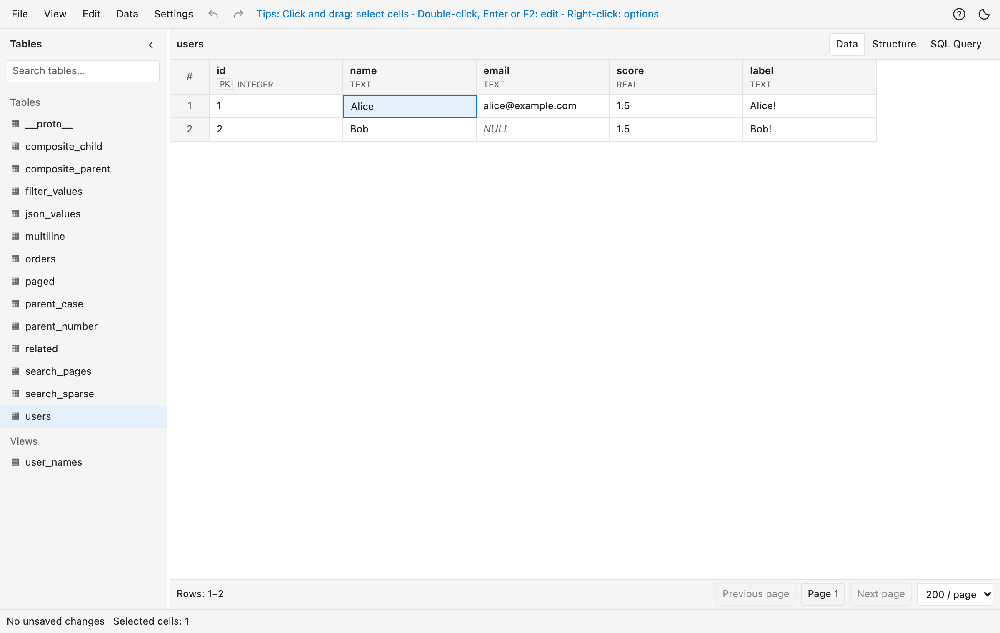
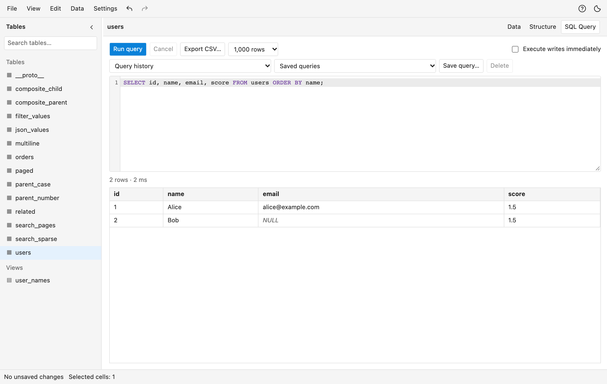

# Neat SQLite

[English](README.md) | 简体中文

在 VS Code 中浏览、查询和编辑本地 SQLite 数据库。通过紧凑的表格处理关联数据，执行自定义 SQL，并导入或导出 CSV。

[在 VS Code Marketplace 安装](https://marketplace.visualstudio.com/items?itemName=xiaomingio.neat-sqlite) · [问题反馈](https://github.com/xiaomingio/neat-sqlite/issues)

支持 Windows、macOS 和 Linux 的 x64 与 ARM64 架构。VS Code 会自动安装与你的平台匹配的扩展包。



## 功能

- 分页浏览数据表和只读视图，支持各列筛选和多列排序
- 可同时按多个字段排序，先添加的字段优先；排序面板列出全部排序字段，可切换方向、调整顺序、查看生成的 `ORDER BY` 并全部重置
- 构建文本、正则、值、数字、空、非空或自定义 WHERE 条件，下方实时预览 SQL；不同字段的条件以 AND 组合
- 选择行、列或不连续单元格；复制和粘贴要求完整矩形选区；状态栏显示所选数值的求和、平均值、最小值和最大值
- 跨表暂存单元格修改、新增、删除、CSV 导入和文本替换，按 Ctrl/Cmd+S 通过一个事务统一保存
- 按 Ctrl/Cmd+F 查找、Ctrl/Cmd+R 替换，在可常驻的紧凑面板中切换全表或精确选区，可选正则表达式与捕获组替换
- 填充选区、向下填充、复制记录，通过记录详情编辑多行文本和 JSON，并沿外键查看关联记录
- SQL 编辑器支持高亮、表名与字段补全、取消执行、查询历史、保存常用查询和结果 CSV 导出
- 创建表、添加、重命名或删除字段、管理索引和视图，并通过 SQL 立即执行写入
- 检查数据库完整性与外键、查看大小，通过 VACUUM 回收空闲空间
- 保留 64 位整数精度，明确区分 NULL 与空字符串
- 查看字段、主键、索引、外键和建表 SQL
- 通过字段映射、类型、NULL 标记和默认值导入 CSV；将当前筛选结果或 SQL 结果导出为 CSV，并创建一致的数据库快照
- 跟随 VS Code 浅色或深色主题，也可手动切换；支持中英文界面

## 表格操作

- 表头第一行显示字段名，第二行显示类型和主键。已激活的排序、筛选按钮以橙色背景常驻；悬停或键盘聚焦时显示全部四个工具。省略号菜单集中提供排序、筛选、固定和隐藏操作
- 工具栏会提示鼠标所在或获得焦点的控件的操作方法
- 使用方向键、Home/End、Ctrl/Cmd+Home/End 和 Page Up/Down 导航，方向键可继续移动到相邻页；按 Enter 或 F2 编辑
- 通过底部分页控件切换页面、调整每页行数或跳页；排序和筛选作用于完整查询，完成后才分页
- 拖动列边缘调整列宽，双击列边缘适应内容
- 表格和 SQL 结果中的多行文本在一行内显示，换行处以 `↵` 标记；编辑、复制、保存与导出保留原文

**显示布局不会修改数据库。** 排序、列顺序、列宽、固定列和隐藏列只影响编辑器中的显示。拖动调整列顺序不会改变数据库文件里的字段顺序：SQLite 只能通过重建数据表来改变字段顺序，这可能影响约束、触发器、视图以及依赖字段位置的程序。

右键行号可新增记录、复制、带字段名复制、编辑记录、复制记录和删除记录。右键已完整选中的行会保留多行选区，其他情况先选中该行。聚焦行号后可按 Context Menu 或 Shift+F10 打开菜单；数据菜单也提供新增记录入口。

## 查找与替换

快捷键和编辑菜单在编辑器右上角打开紧凑的非模态面板，与 VS Code 查找框类似。面板打开时仍可选择单元格或编辑 SQL，新的选区会更新“选区”范围；面板会遮挡定位到的匹配项时移到底部。面板按当前标签操作，Escape 或关闭按钮关闭。在 **SQL 查询** 中，查找与替换针对 SQL 文本，查询结果保持只读。替换 SQL 文本只修改草稿，不执行 SQL；范围可选“全部 SQL”或“选区”（打开搜索时选中的文本），可通过编辑器撤销恢复。在 **数据** 中，按 Ctrl/Cmd+F 打开表格搜索，按 Ctrl/Cmd+R 打开时勾选“替换”。勾选后显示替换文本框和操作，取消勾选时只查找、不修改数据。可以搜索全部字段或指定字段，并通过搜索框旁的 **Aa**（区分大小写，Alt+C）和 **.\***（正则表达式，Alt+R）切换选项。按 Enter 查找全部，再按 Enter 跳到下一项，Shift+Enter 跳到上一项。结果中会高亮每个值的首个匹配。

“全表”覆盖所有分页与待保存修改，忽略当前表格筛选条件。“选区”使用打开搜索时当前已加载页中精确选中的单元格，保留不连续选区。使用选区前在表格中选中单元格；选区过期或数据变化时需要重新选择。首次默认全表，显式选择的范围可以记忆。

正则表达式（**.\***）初始关闭。勾选后支持 RE2 表达式，替换文本可使用 `$1`、`$2` 等编号捕获组；无效或不支持的表达式明确报错。未勾选正则时，替换文本中的 `$1` 等内容保留原义。查找包含文本、数字显示值和生成列，整数精度保持不变，NULL 与 BLOB 不参与文本匹配。替换只修改可编辑的文本值，需要预览后应用，按 Ctrl/Cmd+S 才提交。“替换”（Ctrl/Cmd+Shift+1，或在替换框中按 Enter）只替换当前匹配项并跳到下一项；“下一个匹配项”跳过当前项不做修改；“全部替换”替换所有预览的匹配项。搜索条件或匹配数据变化后需要重新预览。点击结果或使用上一项、下一项定位到单元格；“恢复视图”恢复原有筛选、排序和页码。

## SQL 与 CSV



在 SQL 查询标签中按 Ctrl/Cmd+Enter 执行选中 SQL 或当前语句，每次执行一条。SELECT、WITH 和 VALUES 查询读取已提交的数据；保存表格修改后，查询才能看到这些修改。结果保留 SQLite 类型与 64 位整数精度。只读查询最多执行 5 秒，结果最多 8 MiB，可选择最多 10,000 行；达到行数上限时明确提示。**将当前结果导出为 CSV** 导出屏幕上已有的精确结果，不重新执行查询；达到上限的结果仅导出已显示记录。

字段菜单提供添加、重命名和删除字段的简洁弹窗，展示 SQL 预览，点击“执行”后才修改数据库。操作使用 SQLite 原生 ALTER TABLE；删除字段会由 SQLite 内部重写表数据，存在依赖时可能拒绝执行。

SQL 写入与结构变更通过事务立即提交，操作前需要保存或丢弃待保存的表格修改。这些操作不能在表格中撤销。修改结构前可以创建数据库快照。

外键跳转按 SQLite 的比较规则定位已提交的父记录，并展示其待保存修改。跳转到新建父记录或父记录的新键值前需要保存；标记为待删除的父记录不能打开。

CSV 第一行为字段名，文件最多 8 MiB、10,000 条记录。导入时映射来源列与目标字段、选择存储类型，并指定空字段表示空文本、NULL 还是省略字段以使用默认值。可设置 NULL 标记区分 NULL 与空文本。导入暂存至 Ctrl/Cmd+S 时提交，数据库约束在保存时校验。

## 保存与安全

切换数据表保留待保存修改。Ctrl/Cmd+S 统一提交；违反数据库约束或发现外部修改时停止保存，并保留待保存内容。撤销与重做作用于上次保存或还原之后的修改。视图、虚拟表、生成列和 BLOB 值只读。暂不支持 SQLCipher 加密数据库和远程文件。

**保存数据库快照** 通过 SQLite 备份 API 复制已提交数据，待保存修改保留在编辑器中。**另存为** 生成包含待保存修改的数据库副本。CSV 导出使用当前表与当前查询；NULL 和空字符串均导出为空 CSV 字段。

正则由后端 RE2 在 SQLite 原生条件和排序之后匹配，匹配完成后才切分结果页，并有明确预算；其他筛选由 SQLite 执行。自定义筛选接受受约束的 WHERE 表达式；完整 SQL 语句使用 SQL 查询标签执行。值枚举覆盖完整列与待保存修改，超过限制明确报错。

## 安装

在 VS Code 扩展列表中安装 **Neat SQLite - Database Editor**，或运行 `npm run package` 构建当前平台的 VSIX，在 VS Code 中选择 **扩展 → 从 VSIX 安装…**。打开 `.sqlite`、`.sqlite3`、`.db` 或 `.db3` 文件，或运行 **Neat SQLite: Open Database** 命令。

## 本地开发

需要 Node.js 22 及以上版本和 npm：

```sh
npm install
npm run typecheck
npm test
npm run build
npx playwright install chromium --only-shell
npm run test:ui
npm run package
```

VSIX 输出至 `release/`，对应当前操作系统与 CPU 架构；包内 SQLite 原生模块需要与安装目标平台匹配。运行 `npm run sample` 可生成 `examples/sample-workbench.sqlite`，包含 12,000 条订单、24,000 条明细、关联表、视图和类型边界数据，已有数据库保持不变。[示例指南](examples/README.md) 提供分页练习、SQL 查询与 CSV 导入文件。运行 `npm run icon` 由 `assets/icon.svg` 生成 `assets/icon.png`。

## 许可证

源代码采用 [AGPL-3.0-only](LICENSE) 开源。

Neat SQLite 的名称和 Logo 不随代码授权。基于本项目开发自己的产品时，请使用自己的名称和 Logo，并注明项目来源。
